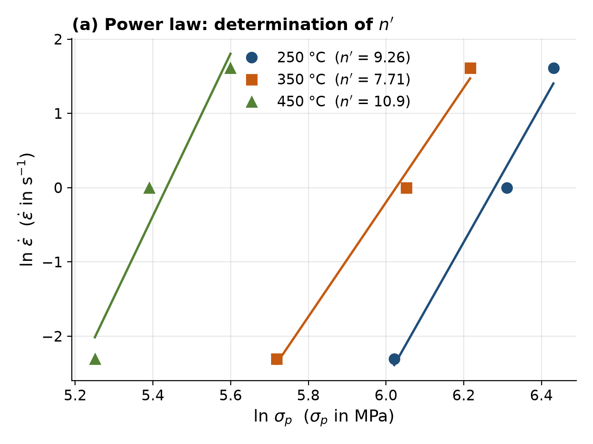
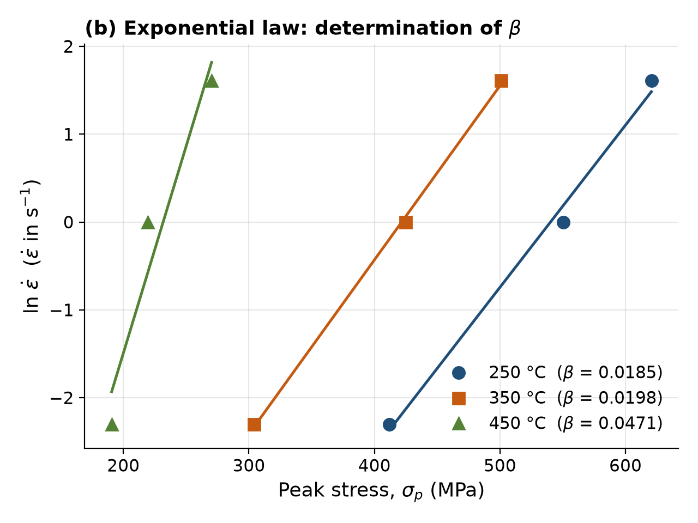
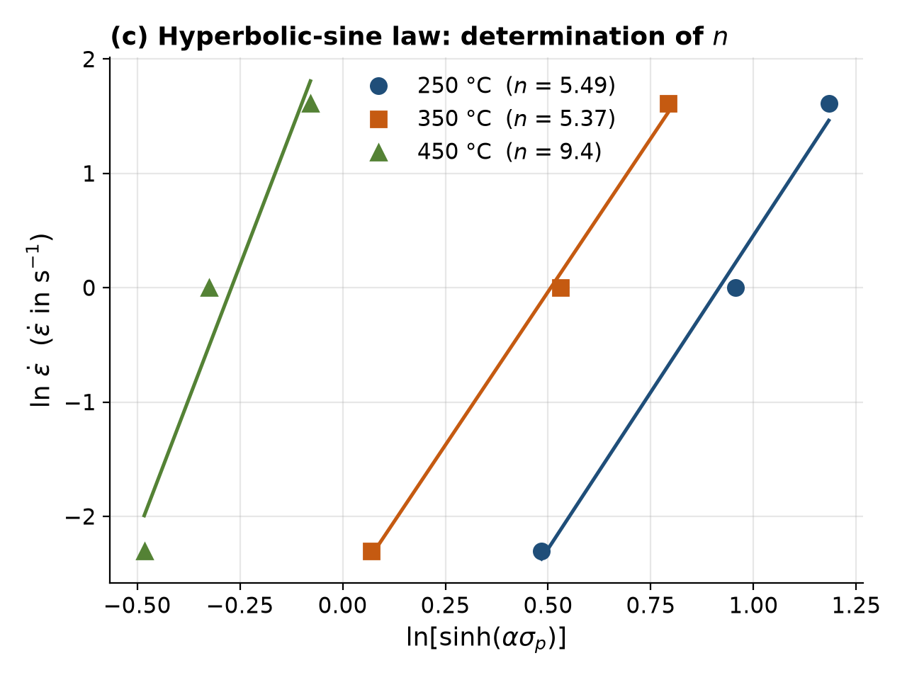
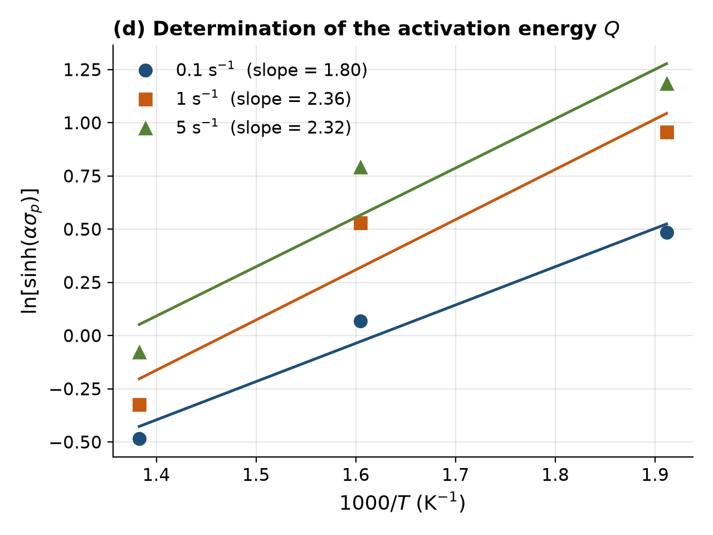
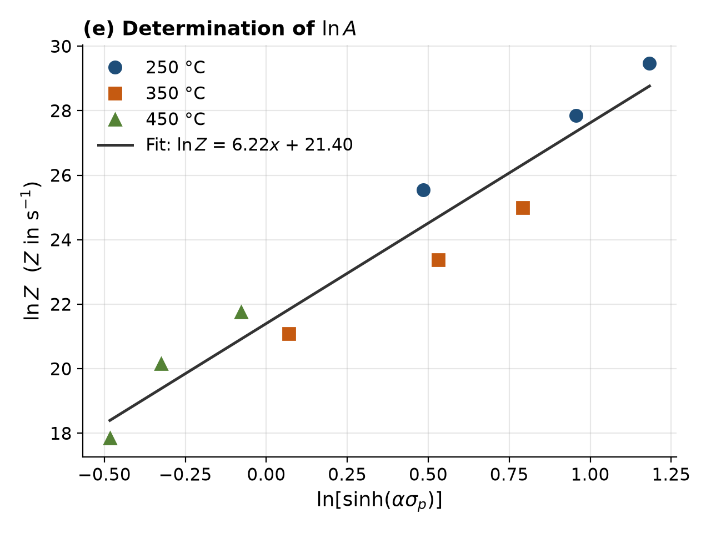
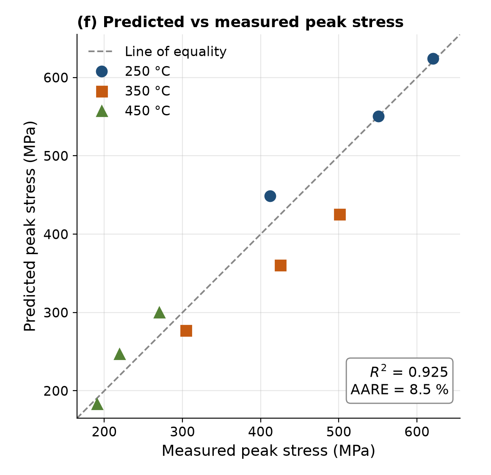

# Hot Deformation Behaviour of a Cu-Zn-Al Shape-Memory Alloy: Hyperbolic-Sine Constitutive Modelling in Python

## Abstract

This repository contains a Python implementation of the constitutive analysis from my BEng thesis at the Federal University of Technology Akure (FUTA), Nigeria. Specimens of a Cu-Zn-Al shape-memory alloy were hot-compressed on a Gleeble 3500 thermomechanical simulator at 250, 350 and 450 °C and at strain rates of 0.1, 1 and 5 s⁻¹, and the peak flow stress was recorded for each condition. The script uses these nine measurements to determine the material constants of the Sellars–Tegart hyperbolic-sine (Arrhenius-type) constitutive equation, generates the standard fitting plots, and evaluates the predictive accuracy of the resulting model. Cu-Zn-Al alloys are low-cost shape-memory alloys of interest for thermally driven actuators, and characterising their hot workability supports the processing of such components.

The code was written as a reproducible, open implementation of the thesis analysis; it is not the original software used to prepare the thesis.

## Method

The dependence of the peak flow stress $\sigma_p$ on strain rate $\dot{\varepsilon}$ and absolute temperature $T$ is described by the Sellars–Tegart equation:

```math
\dot{\varepsilon} = A\left[\sinh(\alpha\sigma_p)\right]^{n}\exp\left(-\frac{Q}{RT}\right)
```

where $A$ (s⁻¹) is a material constant, $\alpha$ (MPa⁻¹) is the stress multiplier, $n$ is the stress exponent, $Q$ (kJ/mol) is the apparent activation energy for hot deformation and $R = 8.314$ J mol⁻¹ K⁻¹ is the universal gas constant.

The constants are obtained by linear regression in the following sequence.

**Step 1: Power law (low-stress approximation).** $\dot{\varepsilon} = A_1 \sigma_p^{n'}$, so $n'$ is the mean slope of $\ln\dot{\varepsilon}$ against $\ln\sigma_p$ over the three test temperatures.

**Step 2: Exponential law (high-stress approximation).** $\dot{\varepsilon} = A_2\exp(\beta\sigma_p)$, so $\beta$ is the mean slope of $\ln\dot{\varepsilon}$ against $\sigma_p$.

**Step 3: Stress multiplier.** $\alpha = \beta / n'$.

**Step 4: Stress exponent.** $n$ is the mean slope of $\ln\dot{\varepsilon}$ against $\ln[\sinh(\alpha\sigma_p)]$ at constant temperature.

**Step 5: Activation energy.** At constant strain rate, $\ln[\sinh(\alpha\sigma_p)]$ is linear in $1000/T$ with slope $K$. Averaging $K$ over the three strain rates gives

```math
Q = 1000\,R\,n\,K
```

**Step 6: Zener–Hollomon parameter and $\ln A$.** The temperature-compensated strain rate is

```math
Z = \dot{\varepsilon}\exp\left(\frac{Q}{RT}\right)
```

and $\ln A$ is the intercept of the linear regression of $\ln Z$ on $\ln[\sinh(\alpha\sigma_p)]$ over all nine points.

**Step 7: Model validation.** The peak stress is back-calculated as

```math
\sigma_p = \frac{1}{\alpha}\sinh^{-1}\left[\left(\frac{Z}{A}\right)^{1/n}\right]
```

and compared with the measured values using the coefficient of determination $R^2$ and the average absolute relative error

```math
\mathrm{AARE} = \frac{100\%}{N}\sum_{i=1}^{N}\left|\frac{\sigma_{\mathrm{meas},i} - \sigma_{\mathrm{pred},i}}{\sigma_{\mathrm{meas},i}}\right|
```

## Data

[`data/peak_stress.csv`](data/peak_stress.csv) contains the peak flow stresses (MPa) obtained from the Gleeble 3500 hot-compression tests, as recorded in the OriginLab project used for the thesis analysis.

| Temperature | 0.1 s⁻¹ | 1 s⁻¹ | 5 s⁻¹ |
|---|---|---|---|
| 250 °C | 412.0 | 550.4 | 620.6 |
| 350 °C | 304.3 | 425.0 | 500.8 |
| 450 °C | 190.6 | 219.3 | 270.3 |

## Results

The fitted constants, as written by the script to [`results_constants.csv`](results_constants.csv), are:

| Constant | Value |
|---|---|
| Power-law exponent, $n'$ | 9.30 |
| Exponential-law constant, $\beta$ (MPa⁻¹) | 0.0285 |
| Stress multiplier, $\alpha = \beta/n'$ (MPa⁻¹) | 0.00306 |
| Stress exponent, $n$ | 6.75 |
| Apparent activation energy, $Q$ (kJ/mol) | 121.2 |
| $\ln A$ ($A$ in s⁻¹) | 21.40 |
| Coefficient of determination, $R^2$ | 0.925 |
| Average absolute relative error, AARE (%) | 8.5 |

The resulting constitutive equation is therefore

```math
\dot{\varepsilon} = 1.97\times10^{9} \left[\sinh(0.00306 \sigma_p)\right]^{6.75}\exp\left(-\frac{1.212\times10^{5}}{RT}\right)
```

with $\dot{\varepsilon}$ in s⁻¹, $\sigma_p$ in MPa, $T$ in K and $Q$ in J/mol.

The model reproduces the peak stresses at 250 °C to within 9 %. At 350 °C it under-predicts by up to 15 %, and at 450 °C it over-predicts the two higher strain rates by 11–13 % (see [`results_predictions.csv`](results_predictions.csv)). The regression slopes at 450 °C ($n' = 10.9$, $n = 9.4$) are larger than those at 250 and 350 °C, which may reflect a change in the dominant softening mechanism at the highest test temperature.

### Notes on the fitting approach

This is a re-implementation of the thesis analysis, so its constants are not identical to those reported in the thesis (thesis: $n$ = 4.54, $Q$ = 154 kJ/mol; this code: $n$ ≈ 6.75, $Q$ ≈ 121 kJ/mol). The code only uses peak stress with simple straight-line fits, so the numbers shift a bit.

In detail, the constants here are derived from peak stresses only, using ordinary least-squares linear regression on the standard linearised plots, with slopes fitted at each temperature (or strain rate, for $Q$) and then averaged. With three data points per regression line, individual slopes are sensitive to scatter in a single test, and other fitting choices (for example flow stresses taken at several strain levels, a single pooled regression, or nonlinear optimisation of the full equation) give somewhat different values.

## Figures

All figures are generated by `hot_deformation.py` and saved to [`figures/`](figures/).

<table>
<tr>
<td width="50%"><br><b>Figure 1.</b> ln <i>ε̇</i> versus ln <i>σ</i><sub>p</sub> at each temperature; the mean slope gives <i>n</i>′.</td>
<td width="50%"><br><b>Figure 2.</b> ln <i>ε̇</i> versus <i>σ</i><sub>p</sub> at each temperature; the mean slope gives <i>β</i>.</td>
</tr>
<tr>
<td width="50%"><br><b>Figure 3.</b> ln <i>ε̇</i> versus ln[sinh(<i>ασ</i><sub>p</sub>)] at each temperature; the mean slope gives <i>n</i>.</td>
<td width="50%"><br><b>Figure 4.</b> ln[sinh(<i>ασ</i><sub>p</sub>)] versus 1000/<i>T</i> at each strain rate; the mean slope <i>K</i> gives <i>Q</i>.</td>
</tr>
<tr>
<td width="50%"><br><b>Figure 5.</b> ln <i>Z</i> versus ln[sinh(<i>ασ</i><sub>p</sub>)] for all nine conditions; the intercept gives ln <i>A</i>.</td>
<td width="50%"><br><b>Figure 6.</b> Predicted versus measured peak stress (<i>R</i>² = 0.925, AARE = 8.5 %).</td>
</tr>
</table>

## How to Run

Requires Python 3.9 or later (tested with Python 3.11).

```bash
git clone https://github.com/techBoo12/cu-zn-al-hot-deformation.git
cd cu-zn-al-hot-deformation
pip install -r requirements.txt
python hot_deformation.py
```

The script prints the intermediate slopes, the fitted constants and a table of measured and predicted stresses; writes `results_constants.csv` and `results_predictions.csv`; and saves the six figures to `figures/`.

## Repository Structure

```
cu-zn-al-hot-deformation/
├── data/
│   └── peak_stress.csv          # measured peak stresses (9 test conditions)
├── figures/                     # fitting and validation plots (generated)
├── hot_deformation.py           # complete analysis script
├── results_constants.csv        # fitted constants, R² and AARE (generated)
├── results_predictions.csv      # measured vs predicted stress (generated)
├── requirements.txt
├── CITATION.cff
├── LICENSE
└── README.md
```

## Author

**Adaikem M. Ajufo**<br>
BEng thesis, Federal University of Technology Akure (FUTA), Nigeria

## Citation

If you use this code, please cite the repository:

```bibtex
@software{ajufo_cuznal_hot_deformation,
  author = {Ajufo, Adaikem M.},
  title  = {Hot Deformation Behaviour of a Cu-Zn-Al Shape-Memory Alloy:
            Hyperbolic-Sine Constitutive Modelling in Python},
  year   = {2026},
  url    = {https://github.com/techBoo12/cu-zn-al-hot-deformation}
}
```

## License

The code in this repository is released under the [MIT License](LICENSE).
